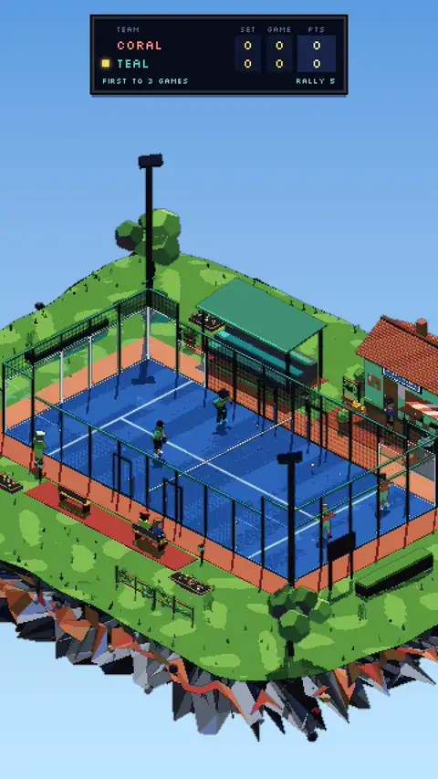

# Glass Court

A pixel-art padel club on a floating island. Four autonomous players. A doubles match that plays itself.



[Watch the full 22-second demo](assets/brag.mp4) · [Explore the source](index.html)

Glass Court is an interactive, self-running **3D padel diorama** built in a single HTML file. Two teams play points, games, sets and complete matches without anyone holding a controller. You can orbit the island, change the light and weather, or leave it running and watch the rallies unfold.

Underneath the pixel art is a Three.js scene, a handwritten ball-physics simulation, and four rule-based agents that predict the ball's path, move into position, and choose their own shots.

## What it does

- **A doubles match that plays itself.** Four AI-controlled players serve, intercept, cover their partners and play out rallies.
- **The ball has physics.** Gravity, drag, spin, bounces, glass and fence rebounds, net contacts and wind influence play.
- **The players make decisions.** Agents anticipate contact points and choose between drives, lobs, volleys, smashes, bandejas, víboras and more.
- **Real match structure.** Serves, faults, lets, 15–30–40 scoring, deuce, games, sets and tiebreaks are simulated.
- **An explorable little world.** Rotate and zoom the floating island; switch between day, golden hour, sunset and floodlit night.
- **A pixel-art 3D renderer.** Custom WebGL2 post-processing handles palette quantization, depth outlines, dithering and crisp upscaling.

## Controls

| Control | What it does |
| --- | --- |
| Drag / Q & E | Rotate the island |
| Scroll / pinch | Zoom |
| Double-click | Reset the camera |
| Time of day / Weather | Change lighting and atmosphere (rain showcases visuals and pauses play) |
| Play style | Auto, defensive, balanced or aggressive |
| Target suggestion | Select a team, then click the far court to suggest a landing target |
| Match | Short exhibition or classic, restart, pause, auto-restart |
| Speed | 0.5×, 1× or 2× |
| Render | Pixel size, palette, dithering, outlines or raw 3D |
| Debug | Predicted ball path and collision visualization |

## How it works

The simulation advances at a fixed **60 Hz**, with **six ball-physics substeps** per tick. A trajectory predictor simulates a copy of the live ball forward; each player's AI evaluates legal, reachable contact windows and coordinates with its partner. A numerical shot solver searches launch angles and bisects speed to land shots at a target.

The world is generated from 3D geometry, then drawn at low resolution and transformed into pixel art through a custom shader pipeline: **depth outlines → tone mapping → 68-color OKLab palette mapping → optional Bayer dithering → pixel upscaling**.

This is **rule-based game AI**, not a trained machine-learning model. The simulated physics is tuned for believable play, not experimentally validated ball dynamics.

**[Read the full technical breakdown →](docs/TECHNICAL.md)** — physics equations and parameters, collision handling, predictive interception, team coordination, shot solving, scoring state machine, character animation and rendering architecture.

## Run

There is no build step or package installation. Serve the directory with a static HTTP server:

```bash
python3 -m http.server 8000
```

Open **http://localhost:8000**. The app requires a WebGL2-capable browser and an internet connection to load Three.js `0.160.0` and Google Fonts.

## Publish

For GitHub Pages: **Settings → Pages → Deploy from a branch → `main` / `/ (root)`**. Since `index.html` is at the root, no build pipeline is needed.

## Files

```text
glass-court/
├── index.html           # The entire application
├── README.md
├── .gitignore
├── docs/
│   ├── demo.webp        # Animated README preview
│   └── TECHNICAL.md     # Architecture and implementation details
└── assets/
    ├── brag.jpg         # Still poster / thumbnail
    └── brag.mp4         # Full 22-second demo
```

Built with JavaScript, Three.js, WebGL2 and GLSL. No frameworks, bundled assets or build tools.
