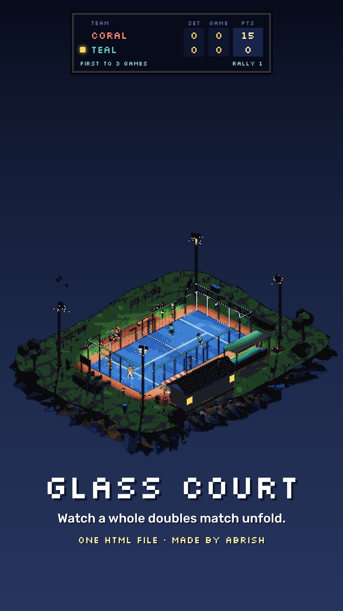

# GLASS COURT 🎾

**A tiny pixel-art padel club on a floating island. Four autonomous players. One complete doubles match. One HTML file.**

Built by **Abrish**.

[](assets/brag.mp4)

**[▶ Watch the 22-second demo](assets/brag.mp4)** · [Source code](index.html)

> The preview above is a clickable image, not an embedded player. For an inline player on GitHub, upload the MP4 as a GitHub attachment and paste the resulting `https://github.com/user-attachments/assets/...` URL on its own line here.

## What is this?

Glass Court is a self-running, interactive **3D padel diorama**. Four simulated players compete in a doubles match without human input. The ball follows a numerical physics model; agents anticipate its trajectory, organize around reachable interceptions, and choose shots. The match keeps score, handles serves and faults, and transitions between points, games, sets, and matches.

It looks like pixel art, but the world is rendered in 3D with **Three.js** and converted to a stylized, low-resolution image by a custom WebGL2 post-processing pipeline.

The entire application—UI, simulation, environment, shaders, AI, and rendering—lives in [`index.html`](index.html). No bundler, framework, npm install, or downloaded art assets are required. An internet connection is required for the external Three.js module and Google Fonts.

## Features

- **Autonomous doubles:** two teams, four agents, positioning, reactions, intercept planning, partner coverage, shot selection, and recovery.
- **Ball physics:** gravity, quadratic aerodynamic drag, Magnus-force spin, ground bounces, glass rebounds, mesh contact, net collisions, and wind.
- **Shot repertoire:** drives, lobs, chiquitas, volleys, blocks, smashes, víboras, bandejas, glass-recovery lobs, and serves.
- **Match engine:** serving, faults/lets, court legality, rally outcomes, traditional 0–15–30–40/advantage scoring, tiebreaks, and short/classic match formats.
- **Procedural 3D diorama:** floating island, court, glass enclosure, floodlights, clubhouse, vegetation, animated spectators, and a dog.
- **Pixel-art shader:** low-resolution rendering, depth-aware outlines, ACES-style tonemapping, a fixed 68-color palette mapped using OKLab color distance, optional Bayer dithering, and integer-pixel-style upscaling.
- **Interactive controls:** rotate/zoom camera, time of day, weather, play style, match format, simulation speed, visual effects, and debugging overlays.

## Run locally

This is a static site. Serve the repository directory over HTTP:

```bash
python3 -m http.server 8000
```

Open **http://localhost:8000**.

You can also use any static-server extension or host. A modern browser with **WebGL2** is required; the app displays an error card if initialization fails. The `three` import is pinned to version `0.160.0` via an import map:

```html
<script type="importmap">
  {"imports":{"three":"https://cdn.jsdelivr.net/npm/three@0.160.0/build/three.module.js"}}
</script>
```

No package manifest is necessary for this release. The browser must be able to load the Three.js CDN and Google Fonts.

## Controls

| Group | Options / behavior |
| --- | --- |
| **Time of day** | Day, golden hour, sunset, night |
| **Weather** | Clear, breezy, overcast, rain showcase *(rain is visual-only and pauses play)* |
| **Play style** | Auto, defensive, balanced, aggressive |
| **Target suggestion** | Choose Coral or Teal, then click the far court to suggest an aiming target |
| **Match** | Short exhibition or classic; new match; pause; auto-restart |
| **Speed** | 0.5×, 1×, 2× |
| **Camera** | Drag to orbit; scroll/pinch to zoom; double-click to reset; Q/E to rotate; optional dynamic camera |
| **Render** | Pixel size, palette, dithering, outlines, raw 3D |
| **Debug** | Predicted ball path and collision visualization |

The layout adapts to mobile viewports; some informational overlays are hidden on smaller screens.

## Technical architecture

The source is intentionally kept in one file, but its runtime separates simulation, procedural scene construction, rendering, and UI controls.

```text
index.html
├── HTML/CSS UI
│   ├── Scoreboard and rally callouts
│   └── Controls, tooltips, fallback
├── Simulation core
│   ├── Ball + stepBall()                   physics integration and collisions
│   ├── TrajectoryPredictor                forward simulation
│   ├── solveShot() + flight()             shot trajectory solving
│   ├── PadelAI + team coordination        anticipation and decisions
│   ├── PlayerSim / Team                   agent state
│   ├── ScoringSystem                      game, set, match score
│   └── MatchController                    match lifecycle / rally adjudication
├── Scene construction
│   ├── Island / court / glass / fencing
│   ├── Floodlights / clubhouse / foliage
│   └── Procedural actors / ambient detail
├── Visuals
│   ├── PersonRig / PlayerView / BallView
│   ├── CameraController / LightingController
│   └── PixelArtRenderer                   low-res, quantize, upscale
└── Main loop                              fixed simulation / interpolated display
```

### 1. Fixed-timestep ball physics

The match advances at **60 simulation ticks per second**, with **6 physics substeps per tick** (360 ball-integration substeps per simulated second). The ball state holds position, linear velocity, spin, rolling state, and out-of-bounds state.

Each free-flight integration accounts for:

```text
acceleration = gravity
             − drag_coefficient × |velocity − wind| × (velocity − wind)
             + magnus_coefficient × (spin × velocity)
```

The coefficients are simulation tuning parameters, not a claim of experimentally calibrated ball dynamics:

| Parameter | In source |
| --- | ---: |
| Gravitational acceleration | `9.81` |
| Ball radius | `0.033` |
| Drag coefficient | `0.0195` |
| Magnus coefficient | `0.00042` |
| Physics tick | `1 / 60` s |
| Substeps per tick | `6` |
| Floor restitution | `0.73` |
| Glass restitution | `0.72` |
| Mesh restitution | `0.30` |

For floor, net-plane, and wall crossings, the collision code estimates the intersection **within** a substep and updates the ball using the remainder of that interval. Floor contact also models friction and spin-related slip. Glass reflects velocity with restitution and tangential damping; fencing absorbs more energy and introduces a deterministic lateral perturbation.

**Why it matters:** rallies, wall rebounds, and scoring arise from simulated state and collision events, rather than a pre-scripted animation sequence.

### 2. Predictive player AI

The agents do not simply follow the ball's current position. `TrajectoryPredictor` **clones the live ball** and advances it through the same `stepBall()` model to anticipate future positions and impacts.

`PadelAI.bestContact()` evaluates possible future contact windows for each player, accounting for:

- Player movement speed, acceleration, reaction delay, and available preparation time.
- Reach and contact height, including overhead and wall-rebound situations.
- Whether a contact is legal (for example, serves must bounce before being returned).
- Contact quality, incoming ball speed, and tactical position.

`planTeam()` chooses the preferred interceptor while the teammate switches to coverage. Agent attributes include small randomized skill variations, so not every exchange resolves identically.

Shot selection uses tactical choices such as drive, lob, volley, bandeja, and víbora. `solveShot()` tries candidate launch angles and **bisects launch speed** to approximate the desired landing position while enforcing clearance constraints. Execution then includes aiming variation.

**This is scripted decision-making / game AI, not a machine-learning model.** The agents use deterministic simulation, heuristics, candidate evaluation, and small stochastic variations.

### 3. Rules and match lifecycle

`MatchController` advances a state machine through setup, positioning, service preparation, first/second serve, live rally, point resolution, score updates, intervals, and match completion. Rally adjudication uses physical events including floor contacts, net interactions, walls, and exits.

`ScoringSystem` models 0/15/30/40, deuce/advantage, game wins, sets, and tiebreaks.

Two formats are exposed:

| Mode | Configuration in code |
| --- | --- |
| Short exhibition | First to 3 games (with a 2-game lead, or tiebreak at 3–3); 1 set |
| Classic | First to 6 games (with a 2-game lead, or tiebreak at 6–6); first to 2 sets |

**Scope:** this is an interactive padel-inspired simulation, not a formally certified implementation of every competition regulation or a guarantee of perfect officiating.

### 4. Custom pixel-art rendering

The app does **not** use pre-rendered sprites to create the main environment. Three.js builds geometric meshes, custom materials, instanced details, and procedural textures. `PixelArtRenderer` transforms the 3D result through a multi-stage GPU pipeline:

1. **Low-resolution scene pass:** render color and depth into a `WebGLRenderTarget` with half-float color storage, depth texture, nearest filtering, and no multisample antialiasing in the offscreen target.
2. **Color and outline pass:** apply ACES-style tone mapping; compare neighboring depth values and darken discontinuities exceeding a `0.5` world-unit depth threshold.
3. **Palette mapping:** convert colors to **OKLab**, match each pixel to the nearest of **68 authored palette colors**, with lightness difference weighted by `1.35`.
4. **Optional dithering:** apply a 4×4 Bayer matrix before the palette snap.
5. **Upscaling pass:** sample whole art pixels with `texelFetch`, retaining hard edges rather than smoothing the pixel grid.

An orthographic camera is adjusted to keep the world origin aligned with the low-resolution pixel grid, reducing shimmering on static geometry. The pixel-size slider changes the art resolution; **Raw 3D** bypasses the stylization pipeline for comparison.

The glass enclosure uses a separate custom shader for tint, Fresnel-weighted sky reflections, highlights, and glints. Alpha-tested textures create fencing; camera-facing walls fade to help keep the rally visible.

### 5. Procedural world and character animation

The island, court, enclosure, clubhouse, foliage, lights, and ambient details are constructed at runtime. The scene uses `InstancedMesh` for repeated geometry such as rocks, foliage, marks, and small objects.

Players use box-based articulated rigs with procedural gait, side-stepping, split-step, and racket swing animation. The animation system includes two-bone inverse kinematics for the racket hand through preparation, impact, and follow-through.

`LightingController` changes sky colors, exposure, and floodlighting for day, golden hour, sunset, and night. `Ambient` animates environmental details and weather. The scene also includes animated spectators and a dog.

### 6. Simulation/render-loop separation

The browser schedules frames with `requestAnimationFrame`, but match simulation uses an **accumulator-based fixed timestep** rather than integrating at arbitrary render-frame durations. The loop clamps elapsed wall time and limits catch-up work to 10 simulation ticks per frame, avoiding an uncontrolled spiral after a stall. Rendering uses interpolation (`alpha`) between simulation steps for smoother display.

The page also suspends frame updates while the document is hidden, adapts renderer pixel ratio on mobile, and exposes a visual debug mode for future-ball trajectories and collision normals.

## Technology

| Layer | Implementation |
| --- | --- |
| Language | JavaScript (ES modules), HTML, CSS |
| 3D engine | Three.js `0.160.0` via jsDelivr import map |
| Graphics | WebGL2, GLSL3 fragment shaders, render targets, depth textures |
| Physics | Handwritten fixed-timestep solver and collision responses |
| AI | Heuristic planning, future-state prediction, trajectory solver |
| Character animation | Procedural pose updates and inverse kinematics |
| Styling | CSS custom properties; Silkscreen, Rubik, JetBrains Mono via Google Fonts |
| Build system | None |

## Deploy with GitHub Pages

1. Push this repository to GitHub.
2. Open **Settings → Pages** in the repository.
3. Under **Build and deployment**, select **Deploy from a branch**.
4. Choose **`main`** and **`/ (root)`**, then save.
5. Open the URL GitHub Pages provides (usually `https://YOUR_USERNAME.github.io/glass-court/`).

`index.html` is already in the repository root, so no build workflow is necessary. The code uses a remotely hosted Three.js module, so Pages visitors need internet access. The live URL can then be added at the top of this README and in the repository's **About** section.

## Repository layout

```text
glass-court/
├── index.html       # All application source: simulation, AI, shaders, UI
├── README.md        # Project showcase and implementation notes
├── .gitignore
└── assets/
    ├── brag.jpg     # Clickable README poster
    └── brag.mp4     # 22-second vertical demo
```

The longer raw `.mov` recording, reel storyboard, and social-copy working files are not required to run the website and are deliberately excluded from this minimal public release.

## Caveats / development notes

- **WebGL2 required:** older devices or disabled hardware acceleration may prevent startup.
- **CDN dependency:** Three.js and fonts are loaded online; this is not an offline-first build.
- **Performance:** palette nearest-neighbor lookup compares against all 68 colors per pixel; art resolution, pixel ratio, shader complexity, and scene detail all affect weaker GPUs.
- **Determinism:** a seeded PRNG (`mulberry32`) and deterministic mesh perturbations exist in the simulator, but ordinary page startup uses a random initial seed; playback is not guaranteed to be identical on every run.
- **Physics fidelity:** interactions are computational approximations tuned for believable play, not an independently validated physical model.
- **Testing:** there is no standalone automated test suite in this repository yet; visual/browser validation is recommended before release.

## Credits

Created by **Abrish**. Three.js is loaded from jsDelivr; UI fonts are provided by Google Fonts.

*Glass Court: a match that plays itself.*
